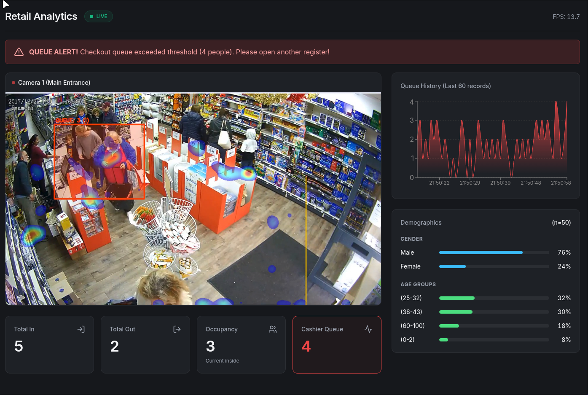
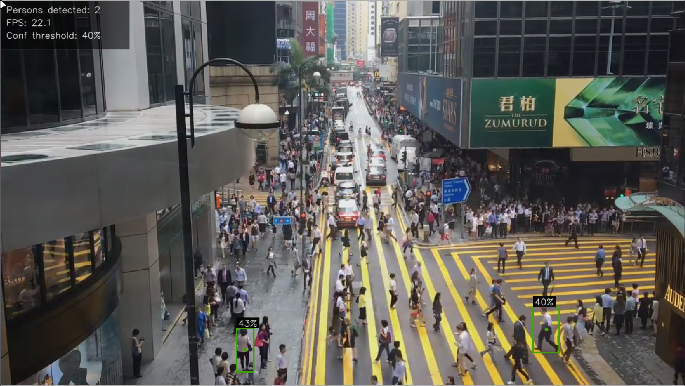
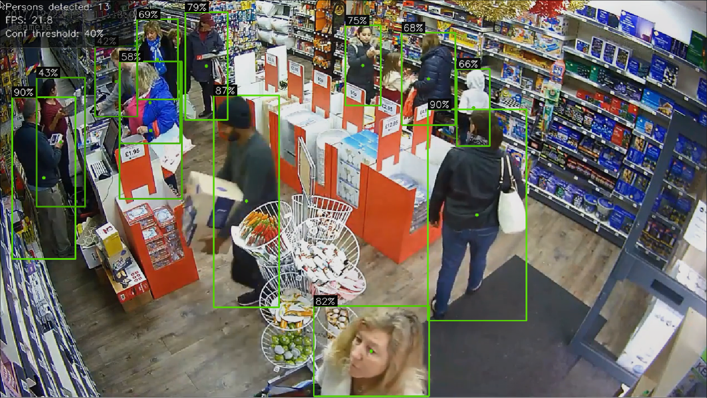

# Retail Intelligence System

A real-time video analytics platform for retail environments. It counts visitors, maps foot traffic heatmaps, monitors checkout queue lengths, and estimates visitor demographics - all without storing any personal identity.

Built to cover production-ready computer vision concepts: object detection, multi-person tracking, zone analytics, heatmap generation, and a real-time streaming dashboard.

---

## Live Dashboard Preview



*Real-time analytics dashboard showing entry/exit counts, queue occupancy, foot traffic heatmap, and FPS metrics.*

---

## Project Structure

```
retail_analytics/
├── detection/          Person detection with YOLO11
├── tracking/           Multi-person tracking + entry/exit counting
├── analytics/          Heatmap, queue monitor, demographic estimation
├── backend/            FastAPI server (WebSocket + MJPEG stream)
└── dashboard/          React live dashboard
```

Each module is standalone and builds on top of the previous one. Later modules import components from earlier ones rather than rewriting them.

---

## Features

| Feature | Module |
|---------|--------|
| Person detection with YOLO11 | `detection/` |
| Multi-person tracking (ByteTrack) | `tracking/` |
| Entry / exit counting via virtual line | `tracking/` |
| Foot traffic heatmap | `analytics/` |
| Checkout queue monitoring + alerts | `analytics/` |
| Age / gender estimation (no identity stored) | `analytics/` |
| Real-time WebSocket backend (FastAPI) | `backend/` |
| Live MJPEG video stream endpoint | `backend/` |
| React live dashboard | `dashboard/` |

---

## Tech Stack

| Layer | Technology |
|-------|------------|
| Detection | YOLO11 (Ultralytics) |
| Tracking | ByteTrack |
| Video processing | OpenCV |
| Demographic estimation | OpenCV DNN + Caffe (Levi & Hassner, 2015) - no TensorFlow required |
| Deep learning runtime | PyTorch (detection/tracking), OpenCV DNN (demographics) |
| Backend | FastAPI + WebSocket + MJPEG StreamingResponse |
| Frontend | React + Vite + Recharts |

---

## Pipeline Architecture

```
Video / Webcam
      │
      ▼
  YOLO11 Detection       ← locate every person in the frame
      │
      ▼
  ByteTrack              ← assign persistent Track ID per person
      │
      ├─────────────┬─────────────┬─────────────┐
      ▼             ▼             ▼             ▼
  Line Counter   Heatmap    Queue Monitor   DeepFace
  (IN / OUT)     (accumulate  (zone density  (age/gender
                  positions)   + alerts)      estimation)
      │             │             │             │
      └─────────────┴─────────────┴─────────────┘
                          │
                          ▼
                  FastAPI Backend
                  ├── /ws          WebSocket - JSON metrics
                  └── /snapshot    MJPEG stream
                          │
                          ▼
                  React Dashboard
```

---

## Modules

### `detection/`

Reads video frames and detects every person using YOLO11. Outputs bounding boxes with confidence scores and a live person count overlay.

### `tracking/`

Adds ByteTrack on top of detection. Each person gets a persistent Track ID across frames. A configurable virtual line at the entrance counts entries and exits without double-counting.

### `analytics/`

Three analytics layers on top of tracking output:

- **Heatmap** - Accumulates foot traffic positions using Gaussian kernels, producing a colored density overlay showing the most visited zones.
- **Queue Monitor** - Counts persons inside a defined zone (e.g. checkout area). Triggers a visual alert when the queue exceeds a configurable threshold.
- **Demographic estimation** - Age range and gender estimated from face crops using OpenCV DNN with pre-trained Caffe models (Levi & Hassner, 2015). No face embeddings or identities are stored; only aggregate statistics are kept.

  > **Note on library choice:** The original design used DeepFace for this feature. However, DeepFace depends on TensorFlow, which has no Python 3.14 support as of mid-2025. We switched to OpenCV DNN + Caffe models, which are TensorFlow-free and work on any Python version where OpenCV is available. Model weights (~88MB) are auto-downloaded on first run.

### `backend/` + `dashboard/`

Wraps the full pipeline in a FastAPI server:

- **`/ws`** - WebSocket endpoint that broadcasts JSON metrics (counts, queue status, FPS, demographics) every N frames
- **`/snapshot`** - MJPEG stream of the processed frame with heatmap and zone overlays

A React frontend connects to both endpoints and displays real-time stat cards, an area chart of queue history, and a live video feed.

---

## Model Selection - Key Finding

During development, two different YOLO11 model sizes were tested on two very different camera angles. The results revealed an important insight about model selection for CCTV use cases.

### Test 1 - Outdoor intersection (wide-angle CCTV view)

`yolo11x.pt` with `confidence = 0.4` on a wide-angle outdoor camera:



**Result: only 2 persons detected.** At this camera angle, people appear very small in the frame. The model struggles because the person features at that scale are too low-resolution for reliable detection.

### Test 2 - Indoor retail store (closer overhead view)

`yolo11x.pt` with `confidence = 0.4` on an indoor retail store camera:



**Result: accurate detections across the full frame.** People occupy a much larger portion of the frame, providing enough pixel detail for the model to work confidently.

### Takeaway

> **`yolo11x.pt` with `confidence = 0.4` works well for indoor overhead views where people appear large.  
> For wide-angle CCTV (outdoor intersections, large plazas), people are too small - consider using a smaller confidence threshold (`0.2–0.3`) or a model fine-tuned on aerial/CCTV datasets.**

This project uses `yolo11n.pt` (nano) by default for real-time performance on CPU/GPU. You can swap the model in `tracking/config.py` → `MODEL_NAME`.

---

## Getting Started

### Prerequisites

- Python 3.10–3.13 (Python 3.14 is supported but `DeepFace` requires 3.11/3.12 for demographic estimation)
- Node.js v18+
- Git

### 1. Clone the repo

```bash
git clone <repo-url>
cd retail_analytics
```

### 2. Set up Python environment

```bash
cd detection
python -m venv venv
source venv/bin/activate   # Windows: venv\Scripts\activate
pip install -r requirements.txt
```

### 3. Run detection only

```bash
python main.py --source 0              # webcam
python main.py --source video.mp4      # video file
```

### 4. Run the full analytics pipeline

```bash
cd ../analytics
source ../detection/venv/bin/activate
python main.py --source ../detection/vid/retail-cctv-footage.mp4 --no-demo
```

> `--no-demo` disables DeepFace if it's not installed. Remove the flag once DeepFace is available.

### 5. Run the backend + dashboard

**Terminal 1 - FastAPI backend:**

```bash
# From repo root
source detection/venv/bin/activate
pip install -r backend/requirements.txt
python backend/main.py
# Server runs at http://localhost:8000
```

**Terminal 2 - React dashboard:**

```bash
cd dashboard
npm install
npm run dev
# Dashboard at http://localhost:5173
```

---

## Configuration

All zone coordinates and thresholds are in `analytics/config.py`. Values use **ratios (0.0–1.0)** relative to the frame, so they work at any resolution.

| Variable | Description | Default |
|----------|-------------|---------|
| `QUEUE_ZONE` | `(x1, y1, x2, y2)` ratio for the checkout monitoring zone | Left-side cashier area |
| `QUEUE_ALERT_THRESHOLD` | Number of persons in zone before alert triggers | `3` |
| `HEATMAP_RADIUS` | Gaussian kernel radius for heatmap blobs | `25` |
| `HEATMAP_ALPHA` | Heatmap overlay transparency | `0.6` |

The counting line position is set in `analytics/main.py` → `build_line()`.

---

## Privacy Design

This system is designed to analyze behavior without identifying individuals:

- Face recognition is **disabled**. DeepFace is used for attribute estimation only (age range, gender).
- No face embeddings are stored or logged.
- No individual trajectories are persisted after a session ends.
- Only aggregate statistics (counts, distributions, heatmap density) are used.

---

## CV Concepts Covered

- Object detection (YOLO11, anchor-free head, NMS)
- Multi-object tracking (ByteTrack, IoU + Kalman filter association)
- People counting (virtual line crossing, directional side detection)
- Heatmap generation (Gaussian accumulation on 2D NumPy array)
- Zone analytics (region of interest, occupancy threshold, alert system)
- Demographic estimation (privacy-preserving facial attribute analysis)
- Real-time video pipeline (frame loop, background threading, WebSocket broadcast, MJPEG streaming)

---

## Known Limitations

| Limitation | Notes |
|-----------|-------|
| Demographic accuracy lower than DeepFace | Caffe models (2015) are less accurate than modern deep learning; sufficient for trend analysis |
| DeepFace not compatible with Python 3.14 | TensorFlow has no Python 3.14 build; switched to OpenCV DNN as TF-free alternative |
| Wide-angle CCTV reduces detection accuracy | People are too small at high zoom-out levels |
| Dashboard video feed is MJPEG (1 req/s) | Not true real-time video; suitable for analytics display |
| Model download required on first run | `analytics/models/` (~88MB) is auto-downloaded via gdown on first startup |

---

## Test Videos & Datasets

YOLO11 is pre-trained on **COCO** (Common Objects in Context), which includes the `person` class - no additional training is required. The videos below were used for development and validation.

| Source | Purpose | Link |
|--------|---------|------|
| COCO Dataset | Pre-training base for YOLO11 person detection | [cocodataset.org](https://cocodataset.org) |
| HD CCTV Retail Store Footage | Indoor detection, queue monitoring, heatmap validation | [YouTube — HDCCTVCameras.net](https://youtu.be/KMJS66jBtVQ?si=G00eXl5hKCCCmqAo) |
| One Minute in Hong Kong — Pedestrian Crossing | Wide-angle outdoor CCTV simulation | [YouTube — penguinsix](https://youtu.be/KMJS66jBtVQ) |

> The retail store video (iProx CCTV, Hikvision NVR) is a real-world 3MP/4MP IP camera installation from a high street homecare products store. It closely represents actual deployment conditions for this system.