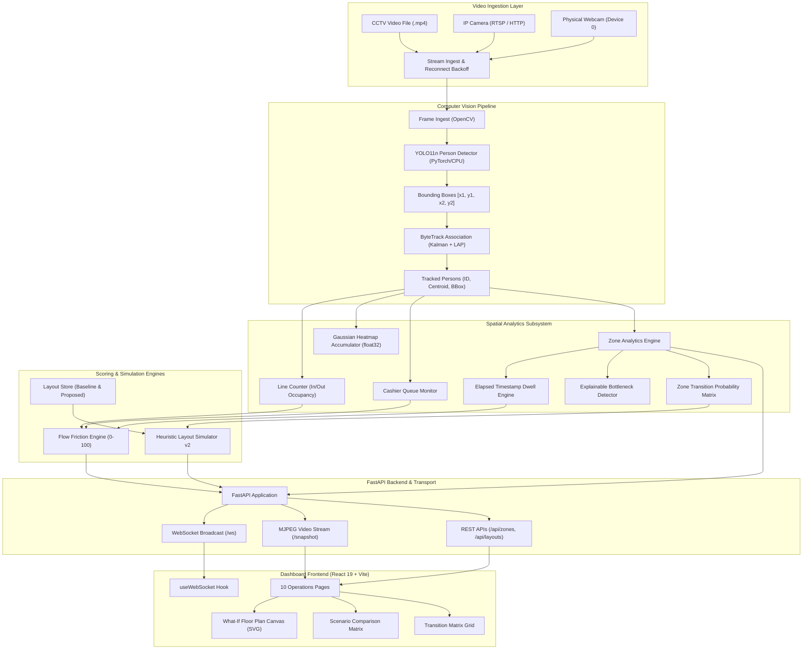

# StorePulse AI — End-to-End System Architecture

**Document:** System Architecture Specification  
**Author:** Omkar Gurav  
**Product:** StorePulse AI — Intelligent Retail Flow & What-If Layout Simulator  
**Version:** 1.0.0  

---

## 1. System Overview & Architecture Diagram

StorePulse AI connects edge computer vision, real-time spatial analytics, and an interactive digital twin into a unified, responsive architecture:



---

## 2. Subsystem Breakdown

### 2.1 Computer Vision & Tracking Engine
- **Module:** `detection/detector.py`, `tracking/tracker.py`, `tracking/counter.py`
- **Detector:** Ultralytics YOLO11n running on the host CPU with Class 0 (`person`) filtering and a confidence threshold of $0.40$. Input coordinates are clamped defensively to frame boundaries.
- **Tracker:** ByteTrack multi-object tracker using Kalman state propagation and linear assignment (`lap==0.5.13`).
- **Tracking Data Structures:**
  ```python
  class TrackedPerson:
      track_id: int
      bbox: Tuple[int, int, int, int]      # x1, y1, x2, y2
      bottom_center: Tuple[int, int]       # Ground contact point
      confidence: float
  ```
- **Pruning Strategy:** Inactive trajectories are pruned after $2 \times \text{track\_buffer}$ (60 frames) of camera absence to prevent memory leakage.

---

### 2.2 Spatial Analytics & Bottleneck Engine
- **Module:** `backend/zone_analytics.py`, `backend/flow_friction.py`
- **Coordinate Space:** Polygons and bottom-center positions are normalized to $[0.0, 1.0]$.
- **Dwell Calculation:** Computes true elapsed duration $\Delta t = t_{\text{exit}} - t_{\text{enter}}$ based on deterministic frame timestamps ($t$), preventing framerate skew.
- **Hysteresis State Machine:**
  ```
  [Inside Zone] ---> (Crosses Boundary) ---> [Pending Exit (2.0s Grace Window)]
                                                    │                   │
                                          (Re-enters within 2.0s) (Grace Expired)
                                                    │                   │
                                                    ▼                   ▼
                                             [Exit Canceled]     [Visit Finalized]
  ```
- **Bottleneck Persistence Window:** Occupancy spikes must sustain for $\ge 4.0\text{s}$ before triggering alerts. Alerts maintain a $1.5\text{s}$ cooldown before clearing.

---

### 2.3 Heuristic What-If Layout Simulator
- **Module:** `backend/simulator.py`, `backend/routers/layouts.py`
- **Walkable Aisle Clearance ($d_{\text{clearance}}$):**
  $$d_{\text{clearance}}(z) = \min_{e \in \text{Fixtures}} \|\text{Centroid}(z) - \text{BBox}(e)\|$$
- **Bottleneck Risk Index (BRI):**
  $$\text{BRI} = \min(100.0, 0.4 \cdot \text{CongestionRatio} + 0.3 \cdot \text{ConflictScore} + 0.3 \cdot \text{Density})$$
- **Fixture Overlap Collision (AABB):** Evaluates fixture bounding boxes to prevent invalid overlapping geometry.
- **Zero-Baseline Mathematical Safety:** Handles zero-baseline metrics cleanly without division-by-zero crashes.

---

### 2.4 FastAPI Asynchronous Backend & Concurrency
- **Module:** `backend/main.py`, `backend/pipeline.py`
- **Threading Model:**
  - `AnalyticsPipeline` runs in a dedicated background daemon thread (`self.thread`), isolating heavy CPU computer vision from API request processing.
  - Inter-thread data access is synchronized using re-entrant `threading.Lock()` wrappers.
  - FastAPI handles HTTP requests and WebSocket connections on the `asyncio` event loop.
- **WebSocket Broadcast:** A lightweight worker task polls the pipeline runner every 100ms and broadcasts telemetry payloads to all active WebSocket clients.

---

### 2.5 React 19 Frontend Dashboard
- **Module:** `dashboard/src/`
- **Tooling:** React 19, Vite 6, React Router v7, Lucide Icons, Recharts.
- **State & Communication:**
  - `useWebSocket`: Custom React hook maintaining persistent WebSocket connection with automatic reconnect.
  - Local State: Fast React state managing the SVG canvas without heavy external canvas libraries.
- **Production Bundle:** Minified, tree-shaken assets yielding $< 750\text{KB}$ JavaScript bundle and $< 20\text{KB}$ CSS.
